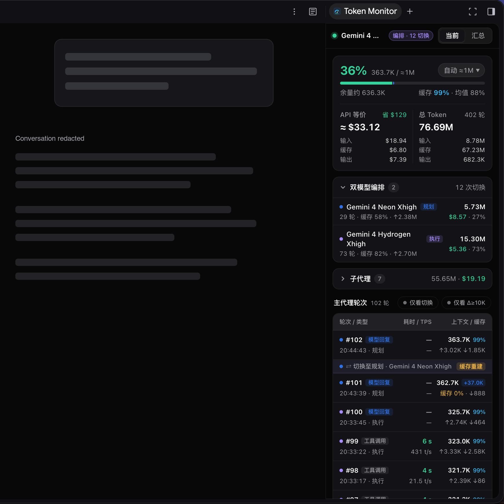
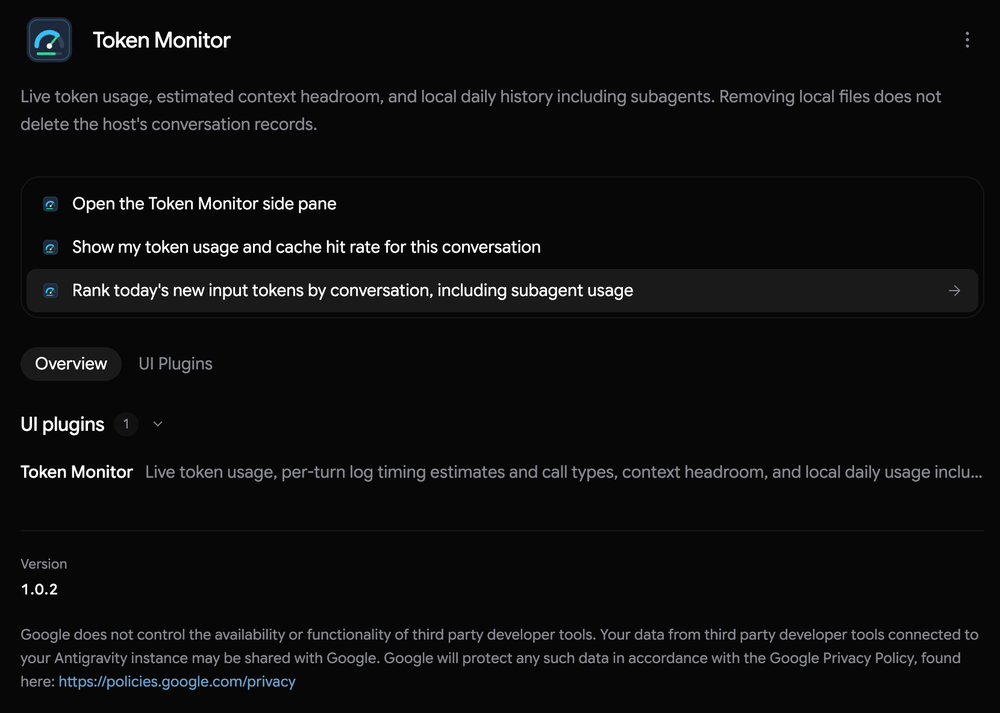

# Token Monitor for Antigravity

Token Monitor is an independent UI plugin for the Google Antigravity desktop app. It turns local conversation logs into a side pane for token usage, cache hits, context headroom, and estimated API cost.

**Opening the monitor adds zero model tokens.** The plugin reads records Antigravity has already written. Its code makes no model API requests or external network calls, and it requires no separate API key. The local sidecar uses CPU, memory, and disk reads to calculate and refresh the display.

<a href="docs/images/token-monitor-demo.png"></a>

The screenshots show the original Chinese interface. The version in this repository uses English labels.

## What it shows

- **Current** shows the latest context window usage, cache hit rate, input and output tokens, and estimated API-equivalent cost.
- **Models and subagents** breaks down usage across the models and agents that contributed to a conversation.
- **Main turns** shows turn type, context changes, cache hits, estimated duration, and tokens per second. Filter by model switches or context changes of at least 10,000 tokens.
- **Overview** shows today's usage and local totals, including subagents. Sort conversations by recent activity or today's new input tokens.

## Install

Use the Antigravity desktop app with UI plugin support and Node.js 24 or later available on its runtime path. The sidecar uses Antigravity's bundled SDK and Node's SQLite support.

```sh
agy plugin install https://github.com/onsraorg/token-monitor
```

Enable **Token Monitor** under **Customizations → Installed** if needed. From a conversation, open **Token Monitor** in the right-hand side pane. The **Overview** tab shows usage across the local stores the plugin can read.

You can also install a local checkout with `agy plugin install /path/to/token-monitor`. See [Antigravity's plugin installation guide](https://antigravity.google/docs/marketplace/#install-from-your-shell-agy-plugin).

<details>
<summary>View Token Monitor in Customizations</summary>



</details>

## Data and estimates

- The sidecar reads local transcripts and opens Antigravity's conversation index in read-only mode. It uses the index to group subagents and may use the start of a local prompt as a display title when the index has no title. The shown data stays in the plugin's local UI.
- The pane refreshes while visible and reuses cached parse results. The **zero additional model tokens** claim applies to opening and using the monitor. Sending a suggested prompt as an Antigravity chat request is a separate host action.
- API-equivalent amounts use the pricing table bundled with this version. They are estimates of comparable API usage. Context limits and time or TPS values can also be estimates. Log intervals can include tool or subagent waits.
- The optional **Delete local files** action in **Overview** permanently removes the selected conversation's local files and its subagents' files after confirmation. The host's conversation index stays intact.

Token Monitor uses Antigravity's [sidecar mechanism](https://antigravity.google/docs/sidecars/) and is maintained independently of Google.

## Development

```sh
agy plugin validate --strict .
node --test sidecars/token-monitor/metrics.test.mjs
```

The tests use temporary data stores and require the local Antigravity SDK at `~/.gemini/antigravity/lib/node_modules/sidecar_sdk/`.
